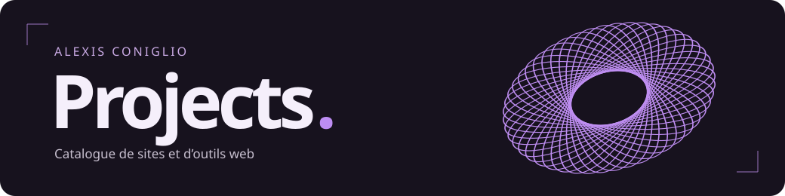

# Projects

Une vitrine pour parcourir mes réalisations web. Chaque fiche présente un projet, son usage et, lorsqu’il est disponible en ligne, un lien pour l’ouvrir.

**[Explorer la vitrine ↗](https://alexis-cgl.github.io/Projects/)** · [Parcourir le catalogue](https://alexis-cgl.github.io/Projects/#catalogue)

## Dans le catalogue

| Projet | À découvrir |
| --- | --- |
| **RackFlow** | Un éditeur visuel pour organiser une baie réseau et suivre le câblage entre ses équipements. Sa fiche se déplie dans le catalogue. |
| **[Portfolio ↗](https://alexis-cgl.github.io/alexis-coniglio/)** | Mon parcours en réseaux et télécommunications et mes réalisations en cybersécurité. |

## Repères dans le dépôt

| Fichier | Rôle |
| --- | --- |
| [index.html](index.html) | Structure de la page, navigation et fiches du catalogue. |
| [assets/css/styles.css](assets/css/styles.css) | Couleurs, mise en page mobile et styles du catalogue. |
| [assets/js/portal.js](assets/js/portal.js) | Tore 3D projeté en canvas, transition au scroll et carrousel. |
| [assets/vendor/](assets/vendor/) | GSAP 3.13.0 et ScrollTrigger, servis localement. |
| [docs/banner.svg](docs/banner.svg) | Bannière de présentation du README. |

## Modifier la vitrine

Ouvre `index.html` dans ton navigateur pour prévisualiser le site en local. Aucune installation ni compilation nécessaire.

Pour ajouter un projet, reprends un bloc `<article>` dans la grille de la section `#catalogue`. Renseigne sa catégorie, son nom, sa description et son lien. Pour présenter un projet sans adresse publique, utilise une fiche dépliable comme celle de RackFlow.

L’anneau respecte le réglage de réduction des animations de l’appareil. Le catalogue et ses liens restent utilisables lorsque JavaScript est désactivé.

## Traverser le portail

La section d’accueil reste épinglée pendant la transition. GSAP ScrollTrigger synchronise le déplacement de l’anneau, son ouverture et l’orbite des cartes avec le défilement. Les mouvements utilisent `power4.inOut`, avec un rattrapage progressif du scroll de 1,2 seconde.

Le carrousel se parcourt au scroll, avec ses deux flèches, au clavier lorsqu’il a le focus ou par un glissement horizontal sur écran tactile. La carte centrale est active. Les cartes latérales restent en retrait jusqu’à leur sélection.

L’animation est désactivée si le visiteur demande une réduction des mouvements ou si la hauteur de sa fenêtre est inférieure à 580 pixels. Les projets sont alors présentés en grille. Si GSAP ne charge pas, cette présentation reste disponible.

### Réglages

Les étapes se trouvent dans la timeline de `assets/js/portal.js`. Les proportions du tore et la projection sur trois axes sont définies dans `project()`. La densité de pixels du canvas est limitée à 1,75 et le rendu est suspendu lorsque la section est hors écran ou l’onglet masqué.

### Bibliothèques

La page utilise HTML, CSS, Canvas et GSAP. Les scripts sont inclus dans le dépôt pour que la visite ne dépende pas d’un CDN. Les conditions de GSAP sont référencées dans [assets/vendor/README.md](assets/vendor/README.md).

